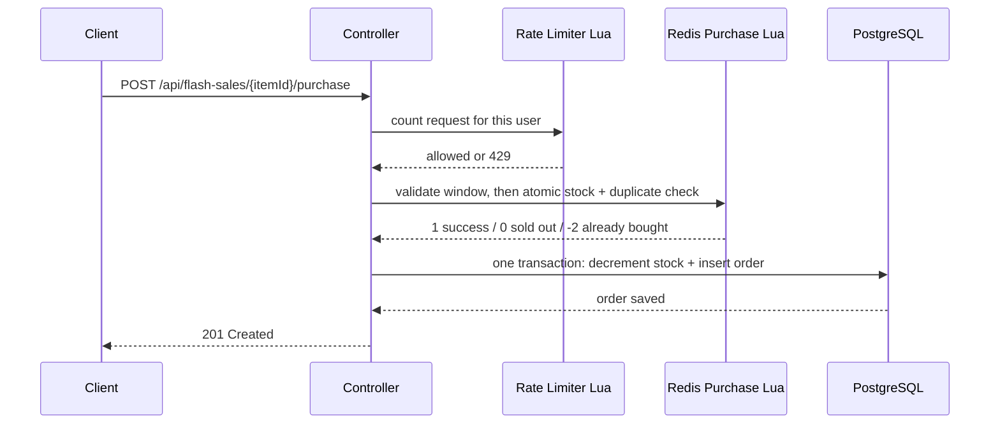

# FlashGrid Backend

A high-concurrency **flash sale backend** built with **Java 25**, **Spring Boot 3.5.9**, **Redis (Lua scripts + Redisson)** and **PostgreSQL**.

When thousands of users hit "Buy" on a limited-stock item at the same instant, naive database code oversells. FlashGrid solves this by making the hot path (stock check, duplicate-buyer check, decrement) a **single atomic Redis Lua script**, then persisting confirmed orders to PostgreSQL.

## Highlights

- **No overselling:** stock is decremented atomically inside Redis with a Lua script.
- **One purchase per user per item:** enforced in Redis (set of buyers) and again in PostgreSQL (unique constraint).
- **Per-user rate limiting:** a Redis Lua fixed-window limiter (5 requests per 10 seconds) returns `429 Too Many Requests`.
- **Distributed lock:** Redisson `RLock` protects sale initialization.
- **Redis + PostgreSQL consistency:** orders and DB stock are written in one transaction; if that fails, the Redis reservation is rolled back (compensation).
- **Optimistic locking:** `@Version` on the stock row plus an atomic `UPDATE ... WHERE stock > 0`.
- **Load tested:** 200 simultaneous users against 10 units of stock produced exactly 10 orders.

## Concurrency Test Result

A built-in load test fires **200 purchase requests at the same instant** from 200 different users for an item with **10 units** of stock.

| Metric | Result |
|---|---|
| Concurrent users | 200 |
| Stock available | 10 |
| Total time for all 200 requests | 389 ms |
| Successful orders (`201`) | **10** |
| Rejected as sold out (`410`) | **190** |
| Redis stock after test | **0** (never negative) |
| PostgreSQL stock after test | **0** |
| Row `version` after test | 10 (exactly 10 database updates) |
| Overselling | **None** |

> Measured on a local laptop with Redis and PostgreSQL running in Docker.

## Tech Stack

| Layer | Technology |
|---|---|
| Language | Java 25 |
| Framework | Spring Boot 3.5.9 (Web, Data JPA, Validation) |
| Cache / atomic operations | Redis 7, Lua scripts via Spring Data Redis |
| Distributed locks | Redisson 3.52.0 |
| Database | PostgreSQL 16 |
| Build | Maven |
| Local infrastructure | Docker Compose |
| Boilerplate reduction | Lombok |

## Architecture



**Purchase flow**

1. **Rate limit:** a Lua script increments a per-user counter and sets a 10-second expiry.
2. **Sale window check:** start time, end time and price are cached in a Redis hash, so no database read is needed.
3. **Atomic reservation:** one Lua script checks stock, checks the buyer set, decrements stock and records the buyer. Redis runs it without interleaving other commands.
4. **Persist:** the order is inserted and the database stock is decremented in a single transaction.
5. **Compensation:** if step 4 fails, the unit is returned to Redis so stock is never lost.

## Project Structure

```
src/main/java/com/flashgrid
├── FlashGridApplication.java
├── config
│   ├── RedisConfig.java          # registers the Lua scripts
│   └── RedissonConfig.java       # Redisson client
├── controller
│   └── FlashSaleController.java  # REST endpoints
├── model
│   ├── FlashItem.java            # @Version optimistic locking
│   ├── Order.java                # unique (user_id, item_id)
│   └── OrderStatus.java
├── repository
│   ├── FlashItemRepository.java  # atomic decrementStock query
│   └── OrderRepository.java
└── service
    ├── FlashSaleService.java     # purchase flow + compensation
    └── RateLimiterService.java   # per-user rate limiting

src/main/resources
├── application.yml
└── scripts
    ├── flash_purchase.lua        # atomic stock + duplicate check
    └── rate_limit.lua            # fixed-window limiter

src/test/java/com/flashgrid
└── ConcurrencyTestRunner.java    # 200-user load test
```

## API

Base path: `/api/flash-sales`

| Method | Endpoint | Description |
|---|---|---|
| `POST` | `/` | Create a flash sale and load stock into Redis |
| `POST` | `/{itemId}/init` | Reload an existing item's sale into Redis |
| `POST` | `/{itemId}/purchase` | Buy one unit (body: `userId`) |
| `GET` | `/{itemId}/stock` | Remaining stock as seen by Redis |

**Create a sale**

```bash
curl -X POST http://localhost:8080/api/flash-sales \
  -H "Content-Type: application/json" \
  -d '{
        "title": "iPhone Flash Deal",
        "stock": 10,
        "price": 999.99,
        "startTime": "2026-10-24T18:00:00",
        "endTime": "2026-10-24T20:00:00"
      }'
```

**Purchase**

```bash
curl -X POST http://localhost:8080/api/flash-sales/1/purchase \
  -H "Content-Type: application/json" \
  -d '{"userId": 101}'
```

**Status codes**

| Code | Meaning |
|---|---|
| `201` | Order created |
| `400` | Invalid request data |
| `404` | Sale not initialized |
| `409` | User already purchased this item |
| `410` | Sold out or sale ended |
| `425` | Sale has not started yet |
| `429` | Rate limit exceeded |

## Rate Limiting

A Redis Lua script implements a fixed-window counter per user:

- `INCR` the user's key; on the first request set a 10-second `EXPIRE`.
- If the count exceeds **5**, the request is rejected with `429` before it reaches stock logic or the database.

Verified behaviour for a single user sending 8 requests in a row: request 1 succeeds, requests 2-5 return `409` (already purchased), requests 6-8 return `429`.

## Getting Started

### Prerequisites

- JDK 25
- Maven 3.9+
- Docker Desktop

### Run locally

```bash
# 1. Start PostgreSQL and Redis
docker compose up -d

# 2. Start the application
mvn spring-boot:run
```

The app starts on `http://localhost:8080`. Tables are created automatically (`ddl-auto: update`).

**Notes**

- The JVM time zone is set to `Asia/Kolkata` in `FlashGridApplication`, because Windows reports the legacy name `Asia/Calcutta`, which newer PostgreSQL rejects.
- On Java 24+, Netty (used by Redisson) logs a `sun.misc.Unsafe` warning. It is harmless; add the JVM option `--sun-misc-unsafe-memory-access=allow` to silence it.

### Run the load test

With the application running, execute `ConcurrencyTestRunner.main()` (from your IDE). It creates a sale with 10 units, fires 200 simultaneous purchases and prints a PASS/FAIL summary.

Expected output:

```
Status counts: {201=10, 410=190}
Redis stock now: {"itemId":2,"availableStock":0}
PASS: exactly 10 orders created, no overselling.
```

## Design Decisions

- **Why Lua?** Check-then-decrement is a race condition when done from application code. A Lua script executes atomically inside Redis.
- **Why also a database constraint?** Redis is the fast gate, but the `(user_id, item_id)` unique constraint guarantees correctness even if Redis state is lost.
- **Why compensation instead of two-phase commit?** Redis and PostgreSQL cannot share a transaction. Reserve in Redis first, persist second, and undo the reservation on failure.
- **Why the `orders` table name?** `ORDER` is a reserved SQL keyword.

## Possible Improvements

- Cancel unpaid orders after a timeout and return their stock.
- Enable Redis persistence (AOF) for the Docker setup.
- Add per-IP rate limiting and a sliding-window algorithm.
- Move order persistence to an async queue (Kafka / RabbitMQ) for even higher throughput.
- Add integration tests with Testcontainers.

## Author

**Mo Ashif**
